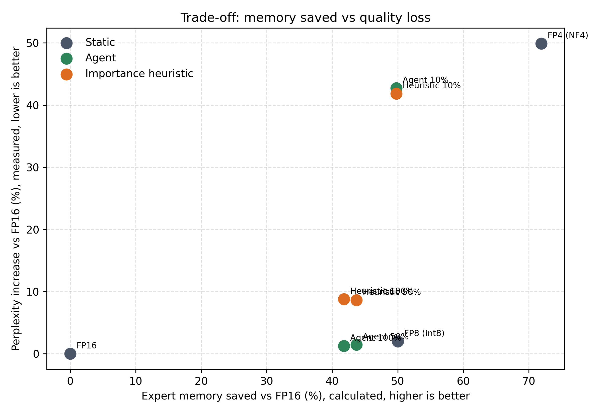
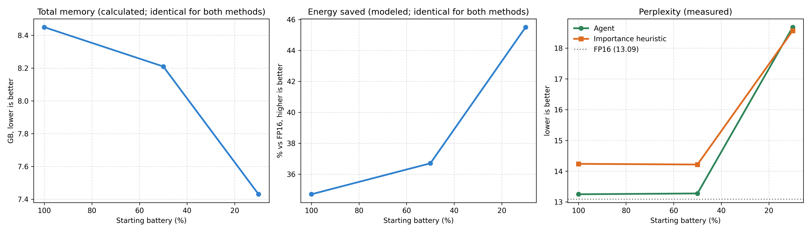
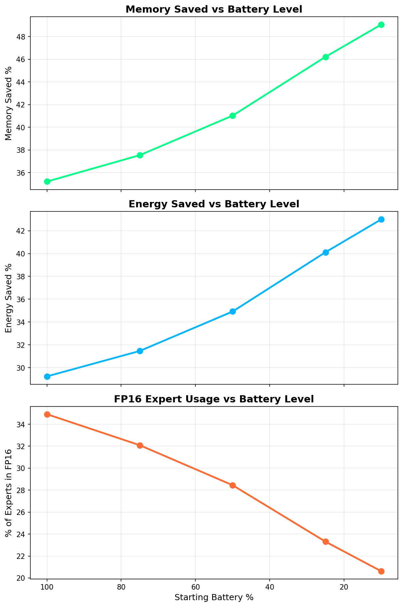

# Adaptive MoE Quantization

An RL-based framework that dynamically assigns per-expert quantization tiers (**FP16 / INT8 / NF4**) in Mixture-of-Experts (MoE) models, adapting in real time to device hardware state (battery, RAM, thermal load). Built on [OLMoE-1B-7B](https://huggingface.co/allenai/OLMoE-1B-7B-0924) (64 experts, top-2 routing), trained via PPO in [Stable-Baselines3](https://github.com/DLR-RM/stable-baselines3), and validated with **true physical mixed-precision inference** on diverse cross-domain benchmarks.

---

## Overview

Large Mixture-of-Experts (MoE) models like OLMoE activate only a sparse subset of experts per token (e.g., 2 of 64), yet **all** expert weights must reside in device memory. On resource-constrained edge and mobile devices, static quantization (applying a uniform precision to all experts) presents a painful dilemma:
- **Uniform FP16**: Excellent quality, but massive memory footprint (~26.7 GB) causing `CUDA Out Of Memory` (OOM) on standard 16 GB GPUs.
- **Uniform NF4 / INT4**: Fits in memory (~8.2 GB), but causes catastrophic quality degradation (perplexity jumps from ~13.08 to ~19.62).

This project frames **per-expert quantization assignment** as a Reinforcement Learning problem. A PPO agent observes per-expert routing importance and hardware telemetry at each step, outputting a 64-dimensional action vector ($a_i \in \{0=\text{FP16}, 1=\text{INT8}, 2=\text{NF4}\}$) to jointly optimize:
1. **Memory footprint reduction** (freeing VRAM/RAM for edge deployment)
2. **Battery and energy preservation** (extending operational life)
3. **Quality preservation** (protecting critical experts from aggressive compression)

---

## System Architecture

```
┌─────────────────────────────────────────────────────────────────────────┐
│                       Observation Space (68-dim)                        │
│  ┌───────────────────────────────────┐  ┌─────────────────────────────┐ │
│  │   Expert Routing Importance       │  │   Hardware State (4-dim)    │ │
│  │   (64-dim, softmax-normalized,    │  │   • battery / 10            │ │
│  │    temperature τ = 1.0)           │  │   • ram_free / 8            │ │
│  │                                   │  │   • drain_rate              │ │
│  │                                   │  │   • thermal flag            │ │
│  └───────────────────────────────────┘  └─────────────────────────────┘ │
└────────────────────────────────────┬────────────────────────────────────┘
                                     │
                                     ▼
                        ┌─────────────────────────┐
                        │     PPO Agent (MLP)     │
                        │     384 → 192 (ReLU)    │
                        └────────────┬────────────┘
                                     │
                                     ▼
                        ┌─────────────────────────┐
                        │  Action: MultiDiscrete  │
                        │  [3]^64 per-expert tier │
                        │  (0=FP16, 1=INT8, 2=NF4)│
                        └────────────┬────────────┘
                                     │
                                     ▼
             ┌──────────────────────────────────────────────┐
             │   Physical In-Place Quantization Dispatch    │
             │   (OlmoeExperts 3D Fused Tensors:            │
             │    gate_up_proj & down_proj slices)          │
             └──────────────────────────────────────────────┘
```

---

## Experimental Results

The project was evaluated in two stages:
1. **RL Policy Optimization** (`adapmoe-ipynb.ipynb`): Training the policy across a 40-turn simulated hardware environment.
2. **Physical Mixed-Precision Validation** (`adaptive-moe-real-benchmark.ipynb`): Deploying the agent on **real OLMoE-1B-7B** weights across **100 diverse prompts** spanning 5 distinct domains (Math, Code, Factual QA, Multi-Step Reasoning, and Chat).

### 1. Real Hardware Mixed-Precision Benchmark

Unlike prior work that relies on surrogate formula estimations, this benchmark applies **real quantization kernels** (unquantized FP16, dynamic INT8 scaling, and block-wise NF4 via `bitsandbytes`) directly to OLMoE's fused 3D expert parameter tensors (`gate_up_proj` and `down_proj`). Perplexity is calculated directly from the cross-entropy loss of the model's actual output logits.

| Configuration | Expert Mem (GB) | Total Mem (GB) | Memory Saved | Real Perplexity (PPL) | % FP16 | % INT8 | % NF4 |
| :--- | :---: | :---: | :---: | :---: | :---: | :---: | :---: |
| **Static All FP16** | 25.77 | 26.73 | Baseline | **13.0872** | 100.0% | 0.0% | 0.0% |
| **Static All INT8** | 12.88 | 13.84 | 48.2% | 13.3455 | 0.0% | 100.0% | 0.0% |
| **Static All NF4** | 7.25 | 8.21 | 69.3% | 19.6175 | 0.0% | 0.0% | 100.0% |
| **Agent (100% Battery)** | **14.97** | **15.93** | **40.4%** | **13.2515** | 20.3% | 70.3% | 9.4% |
| *Importance Heuristic (100% Bat)* | 14.97 | 15.93 | 40.4% | 14.2392 | 20.3% | 70.3% | 9.4% |
| *Random Baseline (100% Bat)* | 14.97 | 15.93 | 40.4% | 18.5837 | 20.3% | 70.3% | 9.4% |
| **Agent (50% Battery)** | **14.51** | **15.47** | **42.1%** | **13.2766** | 18.8% | 67.2% | 14.1% |
| *Importance Heuristic (50% Bat)* | 14.51 | 15.47 | 42.1% | 14.2169 | 18.8% | 67.2% | 14.1% |
| *Random Baseline (50% Bat)* | 14.51 | 15.47 | 42.1% | 18.5860 | 18.8% | 67.2% | 14.1% |
| **Agent (10% Battery)** | **12.95** | **13.91** | **48.0%** | **18.6791** | 20.3% | 34.4% | 45.3% |

<p align="center">
  
</p>

#### Key Takeaways from Real Execution:
* **Crushing the Random Baseline**: At 100% and 50% battery, the RL agent achieves **13.25 and 13.27 PPL** vs. **18.58 PPL** for a random allocation with the exact same memory and precision counts—proving that expert selection is highly non-trivial.
* **Beating the Greedy Importance Heuristic**: The RL agent outperforms the greedy heuristic by nearly **1.0 full perplexity point** (~13.25 vs 14.24), demonstrating that joint reward optimization over routing dynamics yields superior combinations than simply sorting by raw logits.
* **Near-Lossless 40% Compression**: At 100% battery, the agent reduces total model memory from **26.73 GB to 15.93 GB** (enabling inference on a standard 16 GB GPU) with a negligible perplexity change of only **+0.16** over uncompressed FP16.

<p align="center">
  
</p>

---

### 2. Policy Training Diagnostics (`adapmoe-ipynb.ipynb`)

During training across 200,000 timesteps in the multi-turn `AdaptiveMoEEnv`:
- **Captured Alignment**: The agent achieves **59.4% captured alignment** against an oracle baseline (where 0% = random and 100% = theoretical oracle).
- **Importance Correlation**: Spearman rank correlation between expert routing importance and assigned precision reaches **~0.28–0.31** consistently across episodes.
- **Monotonic Resource Scaling**: The policy smoothly shifts allocation from high-precision FP16 to aggressive NF4 compression as the device battery depletes.

<p align="center">
  
  
</p>

---

## 100 Diverse Evaluation Prompts

To prevent benchmark overfitting, the evaluation suite in `adaptive-moe-real-benchmark.ipynb` uses **100 curated prompts** evenly distributed across 5 domains (20 prompts each):
1. **Math & Quantitative Reasoning**: Multi-step word problems, algebra, combinatorics, modular arithmetic, calculus.
2. **Code & Algorithmic Tasks**: Dynamic programming (0/1 knapsack), graph algorithms (Dijkstra, cycle detection), async I/O, regex, data structures.
3. **Factual & World Knowledge**: CRISPR-Cas9 mechanisms, quantum entanglement, astrophysics, economic history, immunology.
4. **Logical & Multi-Step Reasoning**: Deductive syllogisms, balance scale riddles, river crossing, paradox resolution.
5. **Open-Ended Chat & Communication**: Executive proposals, constructive peer reviews, dialogue, structured summarization.

---

## Repository Structure

```
Adaptive-MoE-Quantization/
├── adapmoe-ipynb.ipynb                # Stage 1: RL Environment, PPO Training, Policy Diagnostics
├── adaptive-moe-real-benchmark.ipynb  # Stage 2: Physical Mixed-Precision Benchmarking on OLMoE-1B-7B
├── data/
│   └── routing_dataset_final.json     # 2,264 prompts with extracted OLMoE-1B-7B routing logits (~52 MB)
├── model/
│   ├── best_model.zip                 # Best PPO checkpoint (by evaluation reward)
│   ├── agent.zip                      # Final PPO agent weights
│   └── routing_predictor_best (1).pt  # Supervised routing predictor checkpoint
├── results/
│   ├── implementation_comparison.png  # Real-world memory vs. measured perplexity comparison
│   ├── implementation_tradeoff (2).png# Real Pareto curve (Static vs. Agent vs. Controls)
│   ├── imp_bat.png                    # Precision mix & perplexity vs. battery degradation
│   ├── fig2_pareto_frontier (1).png   # Simulated Pareto frontier
│   └── fig3_stacked_behavior.png      # Multi-panel behavior dashboard
├── .gitignore
└── README.md
```

---

## Environment & Requirements

- Python 3.10+
- PyTorch ≥ 2.1
- [transformers](https://github.com/huggingface/transformers) ≥ 4.44
- [bitsandbytes](https://github.com/TimDettmers/bitsandbytes) ≥ 0.43
- [accelerate](https://github.com/huggingface/accelerate)
- [Stable-Baselines3](https://github.com/DLR-RM/stable-baselines3) ≥ 2.0
- Gymnasium, NumPy, SciPy, Pandas, Matplotlib

Install all required packages:
```bash
pip install torch transformers accelerate bitsandbytes stable-baselines3 gymnasium scipy pandas matplotlib
```

---

## Quickstart & Usage

### 1. Running the Real-World Benchmark on Kaggle
1. Open Kaggle and create a new notebook with the **GPU T4** accelerator (16 GB VRAM).
2. Attach the dataset containing `routing_dataset_final.json` and `best_model.zip`.
3. Upload and run `adaptive-moe-real-benchmark.ipynb`:
   - Profiles static FP16, INT8, and NF4 baselines sequentially (avoiding OOM).
   - Loads base OLMoE weights and physically applies in-place expert precision slices.
   - Evaluates the 100 diverse prompts and generates comparative tables and Pareto plots.

### 2. Inference with the Adaptive Policy

```python
import torch
import numpy as np
from stable_baselines3 import PPO

# 1. Load trained PPO agent
agent = PPO.load("model/best_model.zip", device="cpu")

# 2. Extract router logits and compute sharpened importance
routing_logits = np.array(sample["mean_routing_logits"], dtype=np.float32)
z = (routing_logits - np.mean(routing_logits)) / (np.std(routing_logits) + 1e-8)
e = np.exp((z - np.max(z)) / 1.0)
importance = e / np.sum(e)
routing_features = (importance * 64).astype(np.float32)

# 3. Read hardware telemetry (or simulated state)
# [battery / 10, ram_free / 8, drain_rate, thermal]
hw_vec = np.array([battery_pct / 10.0, ram_free_gb / 8.0, 0.10, 0.0], dtype=np.float32)
obs = np.concatenate([routing_features, hw_vec])

# 4. Predict per-expert quantization tiers
action, _ = agent.predict(obs, deterministic=True)
# action[i] in {0: FP16, 1: INT8, 2: NF4} for each of the 64 experts
```

---

## Citation

```bibtex
@misc{adaptive-moe-quantization,
  title={Adaptive Per-Expert Quantization for Mixture-of-Experts Models via Reinforcement Learning},
  year={2026},
  url={https://github.com/your-username/Adaptive-MoE-Quantization}
}
```

## License

This project is released for academic research and educational purposes.
